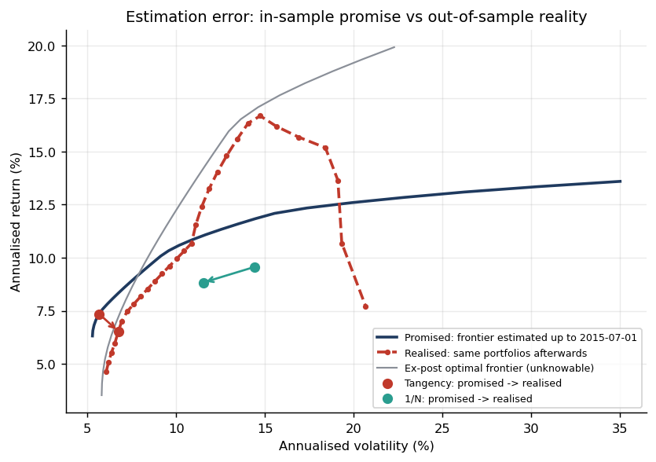
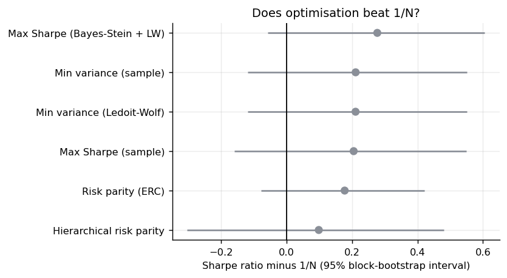
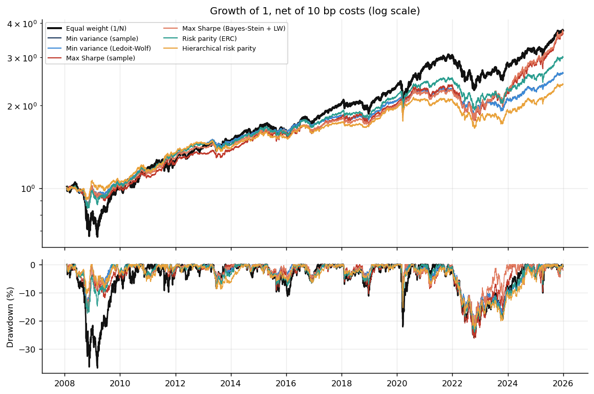
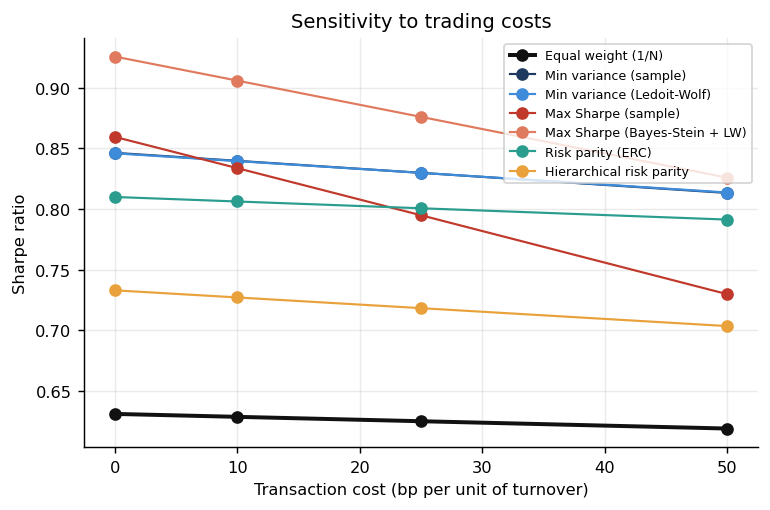

# Portfolio Optimisation: Does Markowitz Beat 1/N Out of Sample?

[](https://github.com/OWNER/portfolio-optimization/actions/workflows/ci.yml)


Mean-variance optimisation looks unbeatable in-sample and is famously fragile
out of sample (DeMiguel, Garlappi & Uppal, 2009). This project builds the
Markowitz efficient frontier and then puts **seven allocation rules** through a
realistic **walk-forward back-test**: monthly rebalancing, a rolling 3-year
window, long-only, a 40% cap per asset for the optimisers, and transaction costs. It then asks
whether any of them *significantly* beats the naive 1/N portfolio.

| Strategy | Idea |
|---|---|
| Equal weight (1/N) | Benchmark: no estimation at all |
| Min variance (sample / Ledoit-Wolf) | Ignore expected returns; shrink the covariance |
| Max Sharpe (sample) | Classic Markowitz tangency portfolio |
| Max Sharpe (Bayes-Stein + Ledoit-Wolf) | Tangency with shrunk means (Jorion 1986) and covariance |
| Risk parity (ERC) | Every asset contributes the same risk |
| Hierarchical risk parity | Cluster-based allocation, no matrix inversion (López de Prado 2016); uncapped, reaches 56% in IEF |

## Key results (10 ETFs, out of sample Feb 2008 to Dec 2025, net of 10 bp costs)

| Strategy | Return | Vol | Sharpe | Max DD | Turnover p.a. | Sharpe vs 1/N (p-value) |
|---|---|---|---|---|---|---|
| Equal weight (1/N) | **7.7%** | 13.1% | 0.63 | -36.7% | 32% | — |
| Min variance (LW) | 5.6% | **6.7%** | 0.84 | **-21.6%** | 44% | +0.21 (0.22) |
| Max Sharpe (sample) | 7.5% | 9.2% | 0.83 | -26.2% | **237%** | +0.21 (0.26) |
| **Max Sharpe (Bayes-Stein + LW)** | 7.6% | 8.5% | **0.91** | -23.1% | 170% | **+0.28 (0.10)** |
| Risk parity (ERC) | 6.3% | 8.0% | 0.81 | -24.0% | 30% | +0.18 (0.15) |
| HRP | 5.0% | 7.0% | 0.73 | -22.9% | 42% | +0.10 (0.63) |

1. **The in-sample promise is not kept.** A tangency portfolio estimated on
   2005–2015 promised a Sharpe ratio of 1.30 and delivered 0.97 over 2015–2025,
   while 1/N delivered more than it promised (0.77 vs 0.66).
2. **Every optimised rule has a higher Sharpe ratio and roughly half the
   drawdown of 1/N, but none is significantly better at 5%.** Over 18 years of
   data, a Sharpe gain of about 0.2 is still within the noise of a block
   bootstrap. That is the DeMiguel et al. point, rediscovered.
3. **1/N still ends with the most wealth.** 6 of its 10 assets are equities, so
   it simply takes more risk. Risk-based rules hold about 58% in bonds (ERC),
   which a falling-rate period rewarded. In 2022 that cushion disappeared:
   every strategy lost 15–21%.
4. **Shrinkage matters for means, not for this covariance.** With 10 assets and
   756 days, Ledoit-Wolf barely moves the covariance (identical min-variance
   results). Shrinking *expected returns* cuts max-Sharpe turnover by 28% and
   raises its Sharpe from 0.83 to 0.91, and it is the only rule still ahead at
   50 bp costs.
5. **Crisis protection:** in the GFC (Sep 2008 to Feb 2009) 1/N lost 28%, while
   HRP was flat (-0.0%) and min variance lost about 5%.

 
 

Full tables (stress periods, cost sensitivity, allocations): [reports/report.md](reports/report.md).
Methods and references: [docs/methodology.md](docs/methodology.md).

## Quick start

```bash
git clone https://github.com/OWNER/portfolio-optimization.git
cd portfolio-optimization
make install     # .venv + package with data and dev extras
make test        # 17 tests, no network needed
make all         # Yahoo Finance data (downloaded once, cached) -> reports/
make demo        # same pipeline on simulated returns
```

```python
from portopt import data as D, optimize as opt

R = D.to_returns(D.load_prices(["SPY", "TLT", "GLD", "EEM"]))
cov = opt.ledoit_wolf_cov(R)
opt.risk_parity(cov), opt.hrp(cov), opt.min_variance(cov, bounds=(0, 0.5))
```

**Using with the risk engine:** the weights from any strategy can be passed to
the companion [market-risk-var](https://github.com/OWNER/market-risk-var) project
(`run_rolling(R, weights, default_models())`) to back-test VaR/ES on the
optimised portfolio.

## Project layout

```
src/portopt/
  data.py       Yahoo Finance loader (cached), simulated universe
  optimize.py   estimators (sample, Ledoit-Wolf, Bayes-Stein), min-var, max-Sharpe,
                frontier, risk parity (Spinu), HRP
  backtest.py   strategies, month-end rebalancing, weight drift, costs
  metrics.py    Sharpe/Sortino/drawdown/VaR-ES, block-bootstrap Sharpe test
  frontier.py   full-sample frontier, in-sample vs out-of-sample frontier
  plots.py, report.py
scripts/run_backtest.py   end-to-end run -> report, figures, metrics.json
```

## What the tests check

* Constrained min-variance matches the closed form when bounds don't bind.
  Weights sum to 1 and respect the cap, and impossible caps are rejected.
* Risk parity equalises risk contributions and gives inverse-vol weights for
  uncorrelated assets.
* The tangency portfolio has the highest Sharpe on the frontier, and the
  frontier is monotonic.
* HRP is **invariant to asset order** (the original algorithm is not; see the
  methodology) and gives inverse-variance weights for 2 uncorrelated assets.
* Back-test: drift, turnover and costs on a hand-worked example; no look-ahead
  (changing future returns leaves past weights unchanged); month-end dates.
* The bootstrap test never rejects identical strategies and detects a large
  difference.

## Limitations

Sharpe ratios use a zero risk-free rate. The universe is fixed with hindsight
(no survivorship issue for ETFs, but the choice of asset classes matters). The
sample covers a long bond bull market. Black-Litterman and factor-based
covariances are natural next steps.

## Author

**Fatima Zahraa Khihil**, Model Risk Analyst, MSc Big Data & Finance (NEOMA).
[LinkedIn](https://linkedin.com/in/fatimazahraakhihil)

License: MIT
