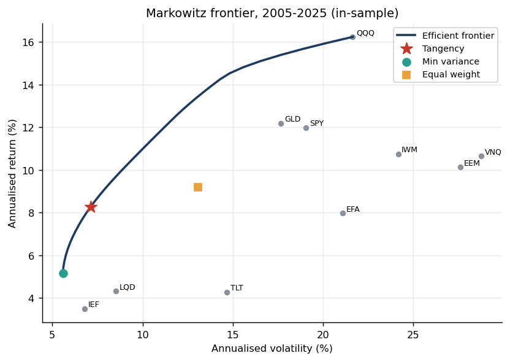
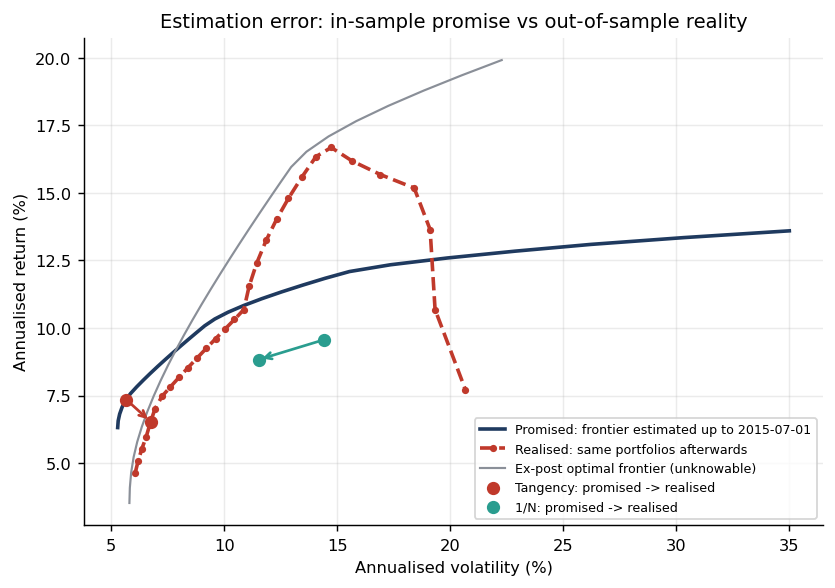
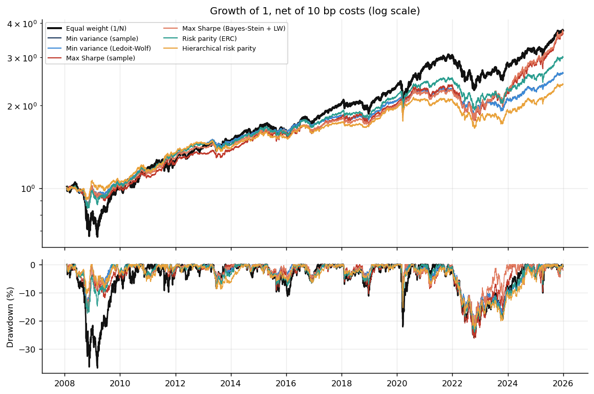
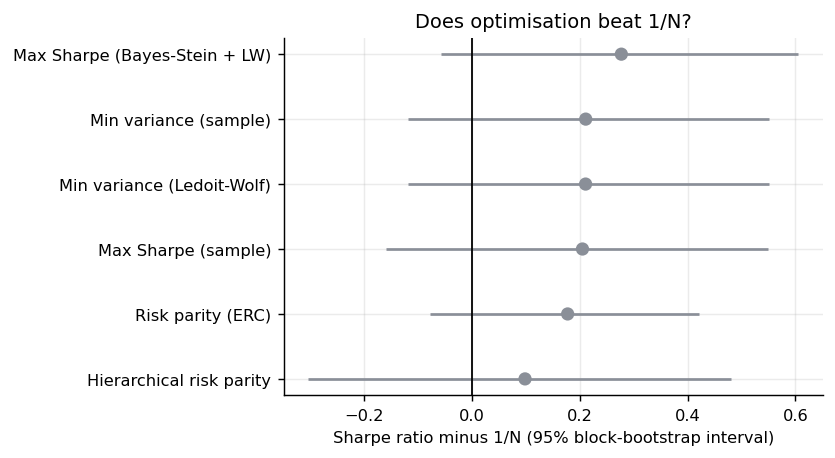
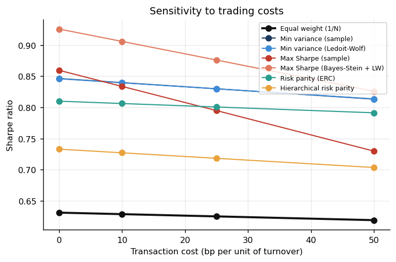
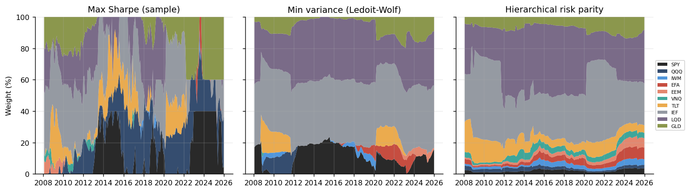

# Portfolio optimisation: walk-forward report

*Data: **yahoo**, 10 ETFs (SPY, QQQ, IWM, EFA, EEM, VNQ, TLT, IEF, LQD, GLD). Out-of-sample period 2008-02-01 to 2025-12-30. Monthly rebalancing on a rolling 756-day window, long-only, max 40% per asset, 10 bp costs.*

Generated by `scripts/run_backtest.py`. Do not edit by hand.

## 1. The Markowitz frontier (full sample, in-sample)

## 2. Estimation error

Frontier estimated on data up to 2015-07-01, then held. The tangency portfolio promised a Sharpe ratio of 1.30 and delivered 0.97; 1/N promised 0.66 and delivered 0.77.

## 3. Walk-forward performance (net of costs)

| strategy | return_% | vol_% | sharpe | sortino | max_dd_% | calmar | turnover_pa_% | var99_% | es99_% |
|---|---|---|---|---|---|---|---|---|---|
| Equal weight (1/N) | 7.68 | 13.14 | 0.63 | 0.89 | -36.70 | 0.21 | 31.64 | 2.35 | 3.46 |
| Min variance (sample) | 5.55 | 6.70 | 0.84 | 1.20 | -21.50 | 0.26 | 45.14 | 1.13 | 1.62 |
| Min variance (Ledoit-Wolf) | 5.55 | 6.71 | 0.84 | 1.20 | -21.64 | 0.26 | 44.20 | 1.13 | 1.62 |
| Max Sharpe (sample) | 7.51 | 9.19 | 0.83 | 1.20 | -26.19 | 0.29 | 237.28 | 1.63 | 2.11 |
| Max Sharpe (Bayes-Stein + LW) | 7.57 | 8.45 | 0.91 | 1.32 | -23.11 | 0.33 | 169.65 | 1.49 | 2.06 |
| Risk parity (ERC) | 6.33 | 8.02 | 0.81 | 1.15 | -24.04 | 0.26 | 30.11 | 1.34 | 1.89 |
| Hierarchical risk parity | 4.99 | 7.04 | 0.73 | 1.04 | -22.88 | 0.22 | 41.97 | 1.21 | 1.65 |

## 4. Does optimisation beat 1/N?

Sharpe ratio difference vs 1/N, circular block bootstrap (21-day blocks, 2000 resamples), two-sided p-value.

| strategy | sharpe_diff | ci_low | ci_high | p_value |
|---|---|---|---|---|
| Min variance (sample) | 0.211 | -0.118 | 0.551 | 0.227 |
| Min variance (Ledoit-Wolf) | 0.211 | -0.118 | 0.550 | 0.224 |
| Max Sharpe (sample) | 0.205 | -0.160 | 0.550 | 0.258 |
| Max Sharpe (Bayes-Stein + LW) | 0.277 | -0.057 | 0.606 | 0.097 |
| Risk parity (ERC) | 0.178 | -0.078 | 0.421 | 0.153 |
| Hierarchical risk parity | 0.098 | -0.304 | 0.482 | 0.632 |

## 5. Stress periods (cumulative return %)

| strategy | GFC Sep08-Feb09 | Euro crisis H2 2011 | COVID Feb-Mar 2020 | Rates 2022 |
|---|---|---|---|---|
| Equal weight (1/N) | -28.32 | 0.12 | -21.09 | -19.67 |
| Min variance (sample) | -5.27 | 10.10 | -9.39 | -15.20 |
| Min variance (Ledoit-Wolf) | -5.41 | 10.23 | -9.36 | -15.42 |
| Max Sharpe (sample) | -3.32 | 6.20 | -7.89 | -20.73 |
| Max Sharpe (Bayes-Stein + LW) | -4.97 | 8.21 | -8.59 | -16.59 |
| Risk parity (ERC) | -10.27 | 8.81 | -12.14 | -18.32 |
| Hierarchical risk parity | -0.01 | 11.37 | -8.58 | -16.42 |

## 6. Transaction costs (Sharpe ratio by cost level, bp)

| strategy | 0 | 10 | 25 | 50 |
|---|---|---|---|---|
| Equal weight (1/N) | 0.63 | 0.63 | 0.63 | 0.62 |
| Min variance (sample) | 0.85 | 0.84 | 0.83 | 0.81 |
| Min variance (Ledoit-Wolf) | 0.85 | 0.84 | 0.83 | 0.81 |
| Max Sharpe (sample) | 0.86 | 0.83 | 0.79 | 0.73 |
| Max Sharpe (Bayes-Stein + LW) | 0.93 | 0.91 | 0.88 | 0.83 |
| Risk parity (ERC) | 0.81 | 0.81 | 0.80 | 0.79 |
| Hierarchical risk parity | 0.73 | 0.73 | 0.72 | 0.70 |

## 7. Allocations over time

