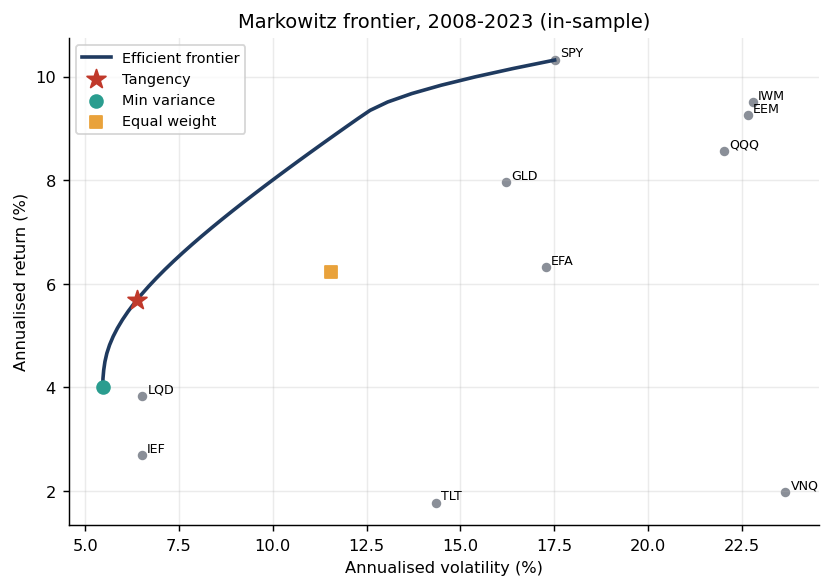
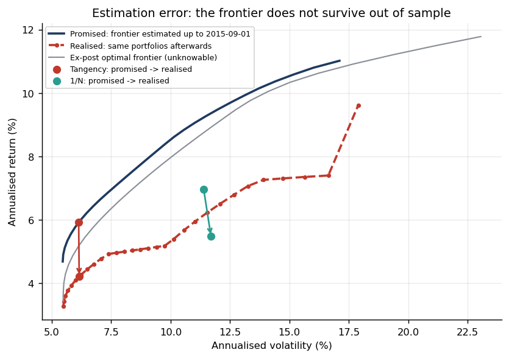
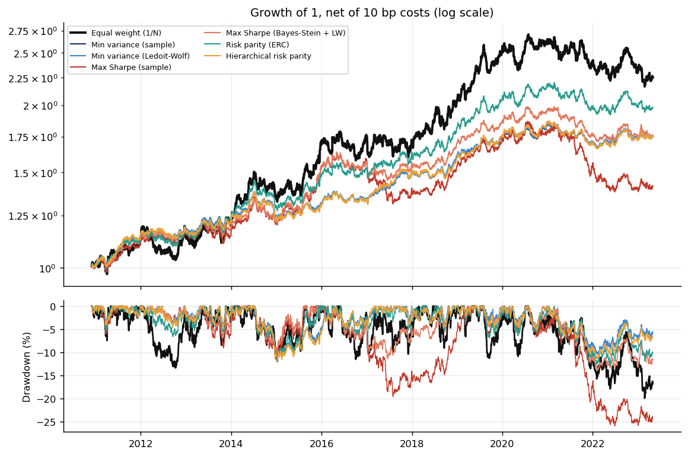
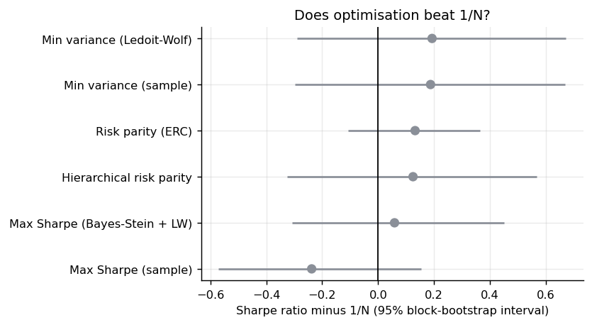
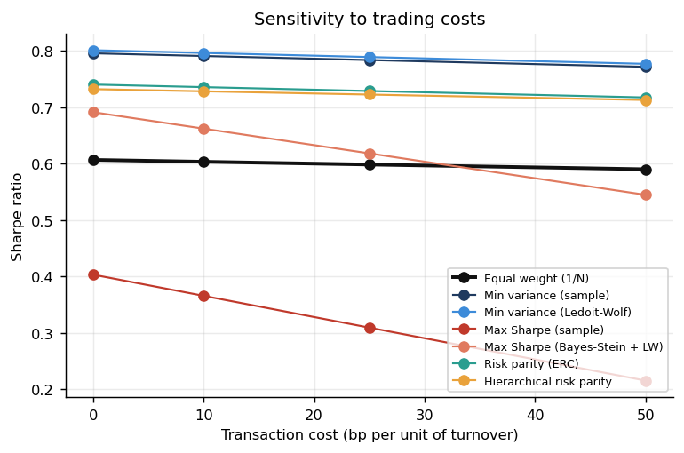
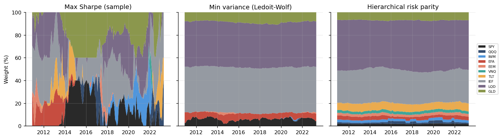

# Portfolio optimisation: walk-forward report

*Data: **synthetic**, 10 simulated assets. Out-of-sample period 2010-12-01 to 2023-05-01. Monthly rebalancing on a rolling 756-day window, long-only, max 40% per asset, 10 bp costs.*

Generated by `scripts/run_backtest.py`. Do not edit by hand.

## 1. The Markowitz frontier (full sample, in-sample)

## 2. Estimation error

Frontier estimated on data up to 2015-09-01, then held. The tangency portfolio promised a Sharpe ratio of 0.96 and delivered 0.68; 1/N promised 0.61 and delivered 0.47.

## 3. Walk-forward performance (net of costs)

| strategy | return_% | vol_% | sharpe | sortino | max_dd_% | calmar | turnover_pa_% | var99_% | es99_% |
|---|---|---|---|---|---|---|---|---|---|
| Equal weight (1/N) | 6.52 | 11.58 | 0.60 | 0.88 | -19.93 | 0.33 | 38.36 | 1.77 | 2.44 |
| Min variance (sample) | 4.43 | 5.69 | 0.79 | 1.17 | -11.04 | 0.40 | 27.16 | 0.86 | 1.03 |
| Min variance (Ledoit-Wolf) | 4.47 | 5.69 | 0.80 | 1.18 | -11.01 | 0.41 | 27.42 | 0.85 | 1.03 |
| Max Sharpe (sample) | 2.73 | 8.31 | 0.37 | 0.53 | -25.93 | 0.11 | 310.83 | 1.34 | 1.70 |
| Max Sharpe (Bayes-Stein + LW) | 4.48 | 6.99 | 0.66 | 1.00 | -13.85 | 0.32 | 203.02 | 1.05 | 1.33 |
| Risk parity (ERC) | 5.45 | 7.61 | 0.74 | 1.08 | -12.89 | 0.42 | 34.85 | 1.13 | 1.48 |
| Hierarchical risk parity | 4.43 | 6.22 | 0.73 | 1.07 | -11.85 | 0.37 | 23.92 | 0.95 | 1.13 |

## 4. Does optimisation beat 1/N?

Sharpe ratio difference vs 1/N, circular block bootstrap (21-day blocks, 2000 resamples), two-sided p-value.

| strategy | sharpe_diff | ci_low | ci_high | p_value |
|---|---|---|---|---|
| Min variance (sample) | 0.187 | -0.298 | 0.669 | 0.427 |
| Min variance (Ledoit-Wolf) | 0.193 | -0.290 | 0.672 | 0.412 |
| Max Sharpe (sample) | -0.238 | -0.570 | 0.154 | 0.203 |
| Max Sharpe (Bayes-Stein + LW) | 0.059 | -0.307 | 0.451 | 0.762 |
| Risk parity (ERC) | 0.132 | -0.108 | 0.364 | 0.259 |
| Hierarchical risk parity | 0.125 | -0.324 | 0.567 | 0.585 |

## 5. Stress periods (cumulative return %)

| strategy | Euro crisis H2 2011 | COVID Feb-Mar 2020 | Rates 2022 |
|---|---|---|---|
| Equal weight (1/N) | 6.90 | 1.94 | -5.11 |
| Min variance (sample) | 5.84 | 2.33 | 1.24 |
| Min variance (Ledoit-Wolf) | 5.84 | 2.35 | 1.25 |
| Max Sharpe (sample) | 7.11 | 3.00 | -10.27 |
| Max Sharpe (Bayes-Stein + LW) | 6.10 | 2.68 | -1.19 |
| Risk parity (ERC) | 5.85 | 2.43 | -0.47 |
| Hierarchical risk parity | 6.40 | 2.04 | 1.17 |

## 6. Transaction costs (Sharpe ratio by cost level, bp)

| strategy | 0 | 10 | 25 | 50 |
|---|---|---|---|---|
| Equal weight (1/N) | 0.61 | 0.60 | 0.60 | 0.59 |
| Min variance (sample) | 0.80 | 0.79 | 0.78 | 0.77 |
| Min variance (Ledoit-Wolf) | 0.80 | 0.80 | 0.79 | 0.78 |
| Max Sharpe (sample) | 0.40 | 0.37 | 0.31 | 0.22 |
| Max Sharpe (Bayes-Stein + LW) | 0.69 | 0.66 | 0.62 | 0.54 |
| Risk parity (ERC) | 0.74 | 0.74 | 0.73 | 0.72 |
| Hierarchical risk parity | 0.73 | 0.73 | 0.72 | 0.71 |

## 7. Allocations over time

